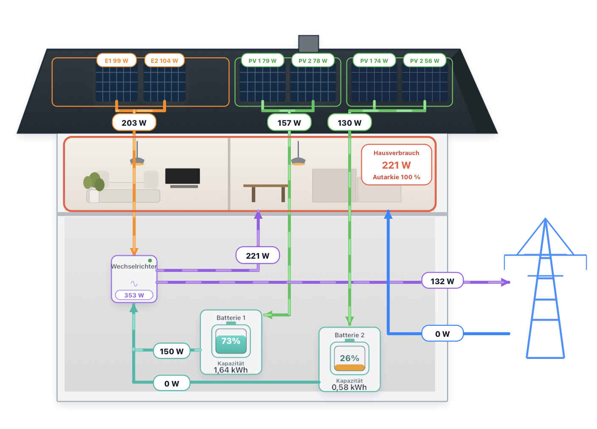

# Solar Flow Card für Home Assistant

[English](README.md) | **Deutsch**

[](https://hacs.dev/)
[](https://github.com/SyntaxSorcerer7/home-assistant-solar-flow-card/releases)
[](LICENSE)

**Woher kommt der Strom für dein Haus gerade, und wie viel hast du heute selbst gedeckt?** Die Solar Flow Card bringt die Messwerte deiner Solaranlage in eine animierte Hausgrafik und in Kacheln für PV, Wechselrichter, Haus, Netz und Speicher. So siehst du auf einen Blick, ob du Strom beziehst, einspeist oder Energie aus dem Speicher nutzt.



Die Card unterstützt **ein bis vier direkte PV-Eingänge** am Wechselrichter und **bis zu zwei Batterien** mit jeweils **einem oder zwei eigenen PV-Eingängen**. Mit passenden Tageszählern zeigt sie auch Erzeugung, Verbrauch, Netzbezug, Einspeisung, Batterieenergie und Autarkie pro Tag. Optionale Tarife ergänzen Bezugskosten, Ersparnis durch Selbstversorgung und den Wert der Einspeisung.

[Installation](#installation) · [Einrichtung im Editor](#einrichtung-im-editor) · [Tageszähler anlegen](#tageszähler-anlegen) · [YAML-Konfiguration](#yaml-konfiguration) · [Changelog](CHANGELOG.md)

## Was du brauchst

- Home Assistant ab **2024.4.0** und ein Dashboard, das du bearbeiten kannst.
- Vorhandene Home-Assistant-Sensoren für die Live-Ansicht: PV-Leistung je aktivem Eingang, **AC-Ausgangsleistung des Wechselrichters** und **saldierte Netzleistung** am Netzanschluss. Mit Speicher kommen pro Batterie die PV-Eingangsleistung je Modul, die Ausgangsleistung zum Wechselrichter und der Ladestand hinzu.
- Optional: Tageszähler für die Energie in Wh oder kWh und Preissensoren für die Kostenanzeige. Die Card liest die Entitäten in Home Assistant. Die Geräteanbindung und gegebenenfalls die Tageszähler richtest du dort ein.

Die Leistungssensoren dürfen W oder kW liefern, der Ladestand wird in Prozent erwartet. Wenn du unsicher bist, welche Entität welchen Wert liefert, prüfe Zustand und Einheit unter **Entwicklerwerkzeuge → Zustände**.

## Installation

### Über HACS (empfohlen)

1. Öffne **HACS** in der Seitenleiste von Home Assistant und suche im Katalog nach **Solar Flow Card**. Bei Bedarf filterst du nach dem Typ **Dashboard**.
2. Öffne den Eintrag und wähle **Herunterladen**. Lade danach die Seite im Browser neu.
3. Öffne dein Dashboard und wähle **Bearbeiten → Karte hinzufügen → Solar Flow Card**.

HACS registriert die JavaScript-Ressource in der Regel automatisch. Wenn du die Dashboard-Ressourcen per YAML verwaltest, ergänze in deiner vorhandenen Ressourcenliste diesen Eintrag:

```yaml
resources:
  - url: /hacsfiles/home-assistant-solar-flow-card/solar-flow-card.js
    type: module
```

Die Grafik ist in der JavaScript-Datei enthalten. Weitere Informationen findest du in der [HACS-Anleitung zum Herunterladen](https://hacs.dev/docs/use/repositories/dashboard/#downloading-a-repository).

### Manuell

1. Lade **solar-flow-card.js** aus den [GitHub-Releases](https://github.com/SyntaxSorcerer7/home-assistant-solar-flow-card/releases) herunter und kopiere sie nach `/config/www/solar-flow-card.js`.
2. Registriere unter **Einstellungen → Dashboards → Ressourcen** die URL `/local/solar-flow-card.js` als **JavaScript-Modul**. Bei YAML-Ressourcen verwende den Eintrag von oben mit dieser URL.
3. Lade die Seite neu und füge die **Solar Flow Card** wie oben zum Dashboard hinzu.

## Einrichtung im Editor

1. **Anlagenaufbau:** Lege zuerst die Zahl der direkten PV-Eingänge (1–4) und der Batterien (0–2) fest. Wähle für jeden aktiven Speicher die Zahl seiner PV-Module (1–2). Bei **0 Batterien** entfallen die Speicherfelder und beide Speicherkacheln.
2. **Live-Leistungen:** Wähle für jeden aktiven PV-Eingang den zugehörigen Leistungssensor in der Reihenfolge deiner Module. Ordne anschließend Wechselrichter-Ausgang und saldierte Netzleistung zu. Pro aktivem Speicher wählst du zusätzlich dessen Ausgangsleistung zum Wechselrichter und den Ladestand.
3. **Haus und Netz:** Lass **Positive Netzleistung ist Bezug** eingeschaltet, wenn der Netzzähler bei Bezug positive und bei Einspeisung negative Werte liefert. Bei umgekehrter Vorzeichenkonvention schalte die Option aus. Optional kannst du einen Sensor für den gesamten Hausverbrauch zuordnen. Sonst berechnet die Card die Hausleistung aus AC-Ausgangsleistung plus Netzbezug minus Einspeisung.
4. **Batterie – Kapazität:** Wähle je Speicher optional einen Sensor für die aktuell gespeicherte Energie oder hinterlege die Gesamtkapazität in kWh. Ohne verfügbaren Energiewert schätzt die Card den Inhalt aus Ladestand × Gesamtkapazität.
5. **PV-Tageserträge einzeln** und **Tageswerte:** Ordne die täglich zurückgesetzten Energiezähler zu. Für jeden PV-Eingang wählst du den Tageszähler desselben Eingangs. Beim Wechselrichter wählst du die **AC-Ausgangsenergie**. Netzbezug und Einspeisung brauchen getrennte Energiezähler. Optional kommen der Hausverbrauch sowie die Lade- und Entladeenergie je Speicher hinzu.
6. **Haus und Netz – Tarife:** Gib bei Bedarf den Bezugspreis und die Einspeisevergütung jeweils als Festpreis in €/kWh oder als Entität in €/kWh oder ct/kWh an. Wenn eine Preisentität eingetragen ist, verwendet die Card diese. Das gilt auch, wenn der Sensor vorübergehend keinen Preis liefert.
7. **Darstellung:** Passe Titel und Dezimalstellen an. Unter **Beschriftung der Dachplatten (optional)** kannst du jedem Eingang bis zu drei Zeichen geben, etwa `Süd` oder `Ost`. Die Kürzel erscheinen in Grafik und Kacheln. Leere Felder behalten die Standardnamen.

Speichere die Karte und prüfe bei bekanntem Netzbezug oder bekannter Einspeisung, ob der richtige Netzpfeil aktiv ist. Vergleiche die angezeigte AC-Leistung mit dem Wechselrichter-Sensor.

## Tageszähler anlegen

Wenn deine Geräte bereits Tagesenergie liefern, kannst du diese Entitäten direkt auswählen. Andernfalls richtest du die Zähler unter **Einstellungen → Geräte & Dienste → Helfer** ein:

1. **Bei einem fortlaufenden Energiezähler:** Erstelle einen [Verbrauchszähler (Utility Meter)](https://www.home-assistant.io/integrations/utility_meter/). Wähle den Energiezähler als Quelle und **Täglich** als Rücksetzzyklus. Der erste Tag kann unvollständig sein.
2. **Wenn nur Leistung vorliegt:** Erstelle zuerst einen [Integral-Helfer](https://www.home-assistant.io/integrations/integration/) mit Zeiteinheit **Stunden**. Bei einer Quelle in W wählst du das Präfix `k`, bei einer Quelle in kW lässt du es leer. Nutze die daraus berechnete Energie anschließend als Quelle für den täglichen Verbrauchszähler.
3. Wiederhole das je Messgröße. Wenn du nur saldierte Netzleistung hast, trenne Bezug und Einspeisung vor der Integration in zwei nichtnegative Leistungssensoren. Bei positivem Bezug entspricht der Bezug `max(Netzleistung, 0)` und die Einspeisung `max(−Netzleistung, 0)`. Bei umgekehrtem Vorzeichen tauschst du die Zuordnung.

## Tagesansicht und Berechnungen

Wähle über das Datumsfeld oder die Pfeile einen vergangenen Tag. Die Kacheln zeigen dann nur die Tageswerte. Die Hausgrafik zeigt weiterhin die aktuellen Stromflüsse. Mit **Heute** kehrst du zu Live- und laufenden Tageswerten zurück.

Die Card liest den letzten gespeicherten numerischen Tageswert vor Mitternacht in der Zeitzone von Home Assistant. Dafür müssen die Tageszähler im **Recorder** erfasst werden und für das gewählte Datum noch Daten in der Historie haben. Fehlende Messwerte erscheinen als **–**. Langzeitstatistiken werden für diese Ansicht nicht ausgewertet.

| Anzeige | So entsteht der Wert |
| --- | --- |
| Hausverbrauch am Tag | Der Haus-Tageszähler hat Vorrang. Sonst gilt AC-Ausgangsenergie des Wechselrichters + Netzbezug − Einspeisung, sofern alle drei Werte vorliegen. |
| Selbstversorgung und Autarkie | Selbst gedeckte Energie ist Hausverbrauch − Netzbezug, mindestens null. Die Tagesautarkie ist ihr prozentualer Anteil am Verbrauch. Ohne positiven Tagesverbrauch erscheint **–**. Die Live-Autarkie in der Grafik verwendet die aktuellen Leistungen für Hausverbrauch und Netzbezug. |
| Wechselrichter-Eingangsenergie | Summe der Tageserträge aller direkten PV-Eingänge plus Entladeenergie der aktiven Speicher. Die AC-Ausgangsenergie wird separat gemessen. |
| PV am Speicher und Ladeenergie | Sind keine Modul-Tageszähler für einen Speicher eingetragen, dient dessen Ladetageszähler als PV-Gesamtwert. Fehlt der Ladewert, kann die vollständige Summe der Modul-Tageszähler einspringen. Diese Näherung passt zu Speichern, die ausschließlich über die zugeordneten PV-Module laden. |
| Bezugskosten und Ersparnis | Bezogene bzw. selbst gedeckte Energie × Bezugspreis. |
| Wert der Einspeisung | Eingespeiste Energie × Einspeisevergütung. Fehlt eine nutzbare Vergütung oder beträgt sie 0, bewertet die Card die Energie zum verfügbaren Bezugspreis und kennzeichnet sie als **nicht vergütet**. |

Historische Kosten verwenden den hinterlegten Festpreis oder den letzten passenden gespeicherten Sensorpreis des gewählten Tages. Fehlt die Preishistorie, übernimmt die Card den aktuellen Sensorpreis nur, wenn dessen letzter Aktualisierungszeitpunkt am oder vor dem Tagesbeginn liegt. Die Kosten sind bei wechselnden Tarifen eine Schätzung auf Basis eines Preises pro Tag.

## YAML-Konfiguration

YAML ist eine Alternative zum visuellen Editor. Füge die Konfiguration im Code-Editor der Karte oder in der Kartenliste eines YAML-Dashboards ein. Das Beispiel zeigt zwei direkte PV-Eingänge und zwei Batterien mit je einem PV-Eingang. Ersetze alle `sensor.*`-Platzhalter durch deine Entitäten. Entferne optionale Zeilen, wenn du keinen passenden Sensor hast.

```yaml
type: custom:solar-flow-card
title: Unsere Solaranlage
pv_direct_inputs: 2
battery_count: 2
pv_battery_inputs: 1
pv_battery_2_inputs: 1
grid_positive_is_import: true
power_decimals: 0
energy_decimals: 2
panel_labels:
  direct: ["Süd", "Ost"]
  battery: ["B1"]
  battery_2: ["B2"]
battery_capacity_kwh: 2.24
battery_2_capacity_kwh: 2.24
grid_import_price_per_kwh: 0.32
grid_export_price_per_kwh: 0.08
entities:
  # Live-Werte
  pv_inputs:
    - sensor.pv_sued_power
    - sensor.pv_ost_power
  battery_pv_inputs:
    - sensor.battery_1_pv_power
  battery_2_pv_inputs:
    - sensor.battery_2_pv_power
  battery_to_inverter: sensor.battery_1_output_power
  battery_2_to_inverter: sensor.battery_2_output_power
  battery_soc: sensor.battery_1_soc
  battery_2_soc: sensor.battery_2_soc
  inverter_output: sensor.inverter_ac_power
  grid_power: sensor.grid_power

  # Optionale Live-Werte
  house_power: sensor.house_power
  battery_energy: sensor.battery_1_stored_energy
  battery_2_energy: sensor.battery_2_stored_energy

  # Optionale Tageswerte
  pv_energy_today:
    - sensor.pv_sued_energy_today
    - sensor.pv_ost_energy_today
  battery_pv_energy_today:
    - sensor.battery_1_pv_energy_today
  battery_2_pv_energy_today:
    - sensor.battery_2_pv_energy_today
  battery_charge_energy_today: sensor.battery_1_charge_energy_today
  battery_discharge_energy_today: sensor.battery_1_discharge_energy_today
  battery_2_charge_energy_today: sensor.battery_2_charge_energy_today
  battery_2_discharge_energy_today: sensor.battery_2_discharge_energy_today
  inverter_energy_today: sensor.inverter_ac_energy_today
  grid_import_energy_today: sensor.grid_import_energy_today
  grid_export_energy_today: sensor.grid_export_energy_today
  house_energy_today: sensor.house_energy_today

  # Preisentitäten statt Festpreisen oben
  # grid_import_price_per_kwh: sensor.electricity_price
  # grid_export_price_per_kwh: sensor.feed_in_tariff
```

- **Ohne Speicher** setze `battery_count: 0` und lass die Speicherfelder weg. **Mit einem Speicher** setze `battery_count: 1` und lass die Felder für Batterie 2 weg.
- Die Leistungslisten brauchen mindestens einen Platz pro aktivem Eingang. Verwende `""` als Platzhalter, falls ein Messwert fehlt. Tageslisten und Beschriftungen folgen derselben Reihenfolge wie die zugehörige Leistungsliste. Freie Plätze können mit `""` erhalten bleiben, damit spätere Einträge dem richtigen Eingang zugeordnet sind.
- Die Standardwerte für `pv_direct_inputs`, `battery_count`, `pv_battery_inputs` und `pv_battery_2_inputs` sind **3**, **1**, **2** und **2**. Gib deinen Anlagenaufbau explizit an, wenn er davon abweicht.

## Wenn etwas fehlt

- **Die Karte erscheint nicht in der Auswahl:** Prüfe, ob die Ressourcen-URL zur gewählten Installation passt und als **JavaScript-Modul** registriert ist. Lade danach den Browser neu.
- **Der Netzpfeil zeigt in die falsche Richtung:** Prüfe das Vorzeichen des Netzzählers bei bekanntem Bezug und passe **Positive Netzleistung ist Bezug** an.
- **Eine Summe zeigt „–“:** Prüfe die zugeordneten Entitäten auf verfügbare Zahlenwerte. Eine PV-Summe braucht die Messwerte aller aktiven Eingänge. Für vergangene Tage prüfe zusätzlich, ob Home Assistant für die Tageszähler noch Historie anzeigt.

[Changelog](CHANGELOG.md) · [Technisches UX-Konzept](docs/UX-KONZEPT.md) · [Lizenz](LICENSE)
