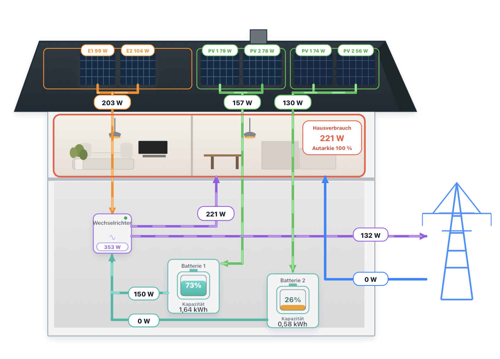

# Solar Flow Card for Home Assistant

**English** | [Deutsch](README.de.md)

[](https://hacs.dev/)
[](https://github.com/SyntaxSorcerer7/home-assistant-solar-flow-card/releases)
[](LICENSE)

**Where is your home's electricity coming from, and how much have you supplied yourself today?** Solar Flow Card brings your solar system's readings together in an animated house diagram and tiles for PV, inverter, home, grid and battery storage. See at a glance when you import or export electricity and when your battery supplies power.



The card supports **one to four direct PV inputs** at the inverter and **up to two batteries**, each with **one or two PV inputs**. With daily energy sensors, it also shows daily generation, consumption, grid imports and exports, battery energy and self-sufficiency. Optional tariffs add import costs, savings from self-supply and the value of exported electricity.

[Installation](#installation) · [Editor setup](#editor-setup) · [Daily energy sensors](#creating-daily-energy-sensors) · [YAML configuration](#yaml-configuration) · [Changelog](CHANGELOG.md)

## Requirements

- Home Assistant **2024.4.0 or later** and an editable dashboard.
- Existing Home Assistant sensors for each active PV input, the inverter's **AC output power**, and **net grid power** at the grid connection. For each battery, you also need PV input power per module, output power to the inverter and state of charge.
- Optional daily energy sensors in Wh or kWh and price sensors for cost calculations. Connect your devices and create any required sensors in Home Assistant first.

Power sensors can report W or kW. State of charge is expected in percent. Check sensor states and units under **Developer tools → States**.

## Installation

### HACS (recommended)

1. Open **HACS** in the Home Assistant sidebar and search for **Solar Flow Card**. Filter by **Dashboard** if necessary.
2. Open the entry and select **Download**, then reload the browser page.
3. Open your dashboard and select **Edit → Add card → Solar Flow Card**.

HACS normally registers the JavaScript resource automatically. If you manage dashboard resources in YAML, add this entry to your existing resource list:

```yaml
resources:
  - url: /hacsfiles/home-assistant-solar-flow-card/solar-flow-card.js
    type: module
```

The diagram is included in the JavaScript file. See the [HACS download instructions](https://hacs.dev/docs/use/repositories/dashboard/#downloading-a-repository).

### Manual installation

1. Download **solar-flow-card.js** from the [GitHub releases](https://github.com/SyntaxSorcerer7/home-assistant-solar-flow-card/releases) and copy it to `/config/www/solar-flow-card.js`.
2. Under **Settings → Dashboards → Resources**, register `/local/solar-flow-card.js` as a **JavaScript module**. For YAML resources, use the entry above with this URL.
3. Reload the page and add **Solar Flow Card** to your dashboard.

## Editor setup

English is the default. In **Appearance → Language**, choose **Deutsch** for German. Set `language: en` or `language: de` in YAML. Existing cards without a language setting switch to English after upgrading. Custom titles and panel labels are preserved.

1. Under **System layout**, set the number of direct PV inputs (1–4), batteries (0–2) and PV modules per active battery (1–2). With zero batteries, the storage fields and tiles are hidden.
2. Under **Live power**, select the sensor for each active PV input in module order, then select inverter AC output and net grid power. For each battery, also select its output power to the inverter and state of charge.
3. Under **Home and grid**, leave **Positive grid power is import** enabled when your grid sensor reports positive values for import and negative values for export. Disable it if the signs are reversed. Optionally select a total home power sensor. Otherwise, the card calculates home power as inverter AC output plus grid import minus export.
4. Under each battery's capacity section, optionally select a stored-energy sensor or enter total capacity in kWh. Without an available energy reading, the card estimates stored energy from state of charge × capacity.
5. Under **Individual daily PV generation** and **Daily values**, assign daily energy sensors. Match each PV counter to its input, use the inverter's **AC output energy**, and provide separate grid import and export counters. Home consumption and battery charge and discharge counters are optional.
6. Under **Home and grid**, optionally enter import and export tariffs as fixed prices in €/kWh or entities in €/kWh or ct/kWh. A configured price entity takes precedence, including when it temporarily has no valid value.
7. Under **Appearance**, adjust the title and decimal places. Under **Roof panel labels (optional)**, give each input up to three characters. Labels appear in the diagram and tiles. Empty labels retain the defaults.

Save the card and check the active grid arrow during a known import or export. Compare the displayed AC power with the inverter sensor.

## Creating daily energy sensors

If your devices already provide daily energy sensors, select those directly. Otherwise, create helpers under **Settings → Devices & services → Helpers**:

1. For a cumulative energy sensor, create a [Utility Meter](https://www.home-assistant.io/integrations/utility_meter/), select the energy sensor as its input and set the reset cycle to **Daily**. The first day can be incomplete.
2. If you only have power readings, first create an [Integral helper](https://www.home-assistant.io/integrations/integration/) using **hours**. For a W source, select the `k` prefix. For a kW source, leave the prefix empty. Use the resulting energy sensor as the source for a daily utility meter.
3. Repeat for each measurement. If you only have net grid power, split import and export into two nonnegative power sensors before integration. With positive import, use `max(grid power, 0)` for import and `max(−grid power, 0)` for export. Reverse the assignment for the opposite sign convention.

## Daily view and calculations

Select a past date using the date field or arrows. The tiles then show daily values only, while the house diagram continues to show live flows. Select **Heute** (today) to return to live and current daily values.

The card reads the last stored numeric daily reading before midnight in Home Assistant's time zone. The daily sensors must be recorded by **Recorder**, and history must still exist for the selected date. Missing values appear as **–**. Long-term statistics are not used for this view.

| Display | Calculation |
| --- | --- |
| Daily home consumption | The home daily counter takes precedence. Otherwise, inverter AC output energy + grid import − grid export, provided all three readings are available. |
| Self-supply and self-sufficiency | Self-supplied energy is home consumption − grid import, at least zero. Daily self-sufficiency is its percentage of consumption. With no positive daily consumption, **–** appears. Live self-sufficiency uses current home and grid import power. |
| Inverter input energy | Daily yields from all direct PV inputs plus discharge energy from active batteries. AC output energy is measured separately. |
| Battery PV and charge energy | If no module daily counters are configured for a battery, its daily charge counter supplies the PV total. If the charge counter is unavailable, the complete sum of module counters can be used instead. This approximation suits batteries charged only by their assigned PV modules. |
| Import costs and savings | Imported or self-supplied energy × import price. |
| Export value | Exported energy × feed-in tariff. If no usable tariff is available or it is zero, the card values export at the available import price and marks it as **nicht vergütet** (not compensated). |

Historical costs use the fixed price or the last suitable recorded sensor price for the selected day. If price history is missing, the current sensor price is used only when its last update was at or before the start of that day. Costs for changing tariffs are estimates based on one price per day.

## YAML configuration

YAML is an alternative to the visual editor. Add the configuration in the card's code editor or a YAML dashboard's card list. This example uses two direct PV inputs and two batteries with one PV input each. Replace all `sensor.*` placeholders with your entities and remove optional entries you do not have.

```yaml
type: custom:solar-flow-card
language: en
title: Our solar system
pv_direct_inputs: 2
battery_count: 2
pv_battery_inputs: 1
pv_battery_2_inputs: 1
grid_positive_is_import: true
power_decimals: 0
energy_decimals: 2
panel_labels:
  direct: ["Süd", "Ost"]
  battery: ["B1"]
  battery_2: ["B2"]
battery_capacity_kwh: 2.24
battery_2_capacity_kwh: 2.24
grid_import_price_per_kwh: 0.32
grid_export_price_per_kwh: 0.08
entities:
  # Live readings
  pv_inputs:
    - sensor.pv_sued_power
    - sensor.pv_ost_power
  battery_pv_inputs:
    - sensor.battery_1_pv_power
  battery_2_pv_inputs:
    - sensor.battery_2_pv_power
  battery_to_inverter: sensor.battery_1_output_power
  battery_2_to_inverter: sensor.battery_2_output_power
  battery_soc: sensor.battery_1_soc
  battery_2_soc: sensor.battery_2_soc
  inverter_output: sensor.inverter_ac_power
  grid_power: sensor.grid_power

  # Optional live readings
  house_power: sensor.house_power
  battery_energy: sensor.battery_1_stored_energy
  battery_2_energy: sensor.battery_2_stored_energy

  # Optional daily readings
  pv_energy_today:
    - sensor.pv_sued_energy_today
    - sensor.pv_ost_energy_today
  battery_pv_energy_today:
    - sensor.battery_1_pv_energy_today
  battery_2_pv_energy_today:
    - sensor.battery_2_pv_energy_today
  battery_charge_energy_today: sensor.battery_1_charge_energy_today
  battery_discharge_energy_today: sensor.battery_1_discharge_energy_today
  battery_2_charge_energy_today: sensor.battery_2_charge_energy_today
  battery_2_discharge_energy_today: sensor.battery_2_discharge_energy_today
  inverter_energy_today: sensor.inverter_ac_energy_today
  grid_import_energy_today: sensor.grid_import_energy_today
  grid_export_energy_today: sensor.grid_export_energy_today
  house_energy_today: sensor.house_energy_today

  # Price entities instead of fixed prices above
  # grid_import_price_per_kwh: sensor.electricity_price
  # grid_export_price_per_kwh: sensor.feed_in_tariff
```

- For **no battery**, set `battery_count: 0` and omit battery fields. For **one battery**, set `battery_count: 1` and omit battery 2 fields.
- Power lists need at least one slot per active input. Use `""` as a placeholder for a missing reading. Daily lists and labels follow the same order as their corresponding power list. Preserve empty slots with `""` to keep later entries aligned.
- Defaults for `pv_direct_inputs`, `battery_count`, `pv_battery_inputs` and `pv_battery_2_inputs` are **3**, **1**, **2** and **2**. Set these explicitly to match your system.

## Troubleshooting

- **Card missing from the picker:** Check that the resource URL matches your installation and is registered as a JavaScript module, then reload the browser.
- **Grid arrow points the wrong way:** Check the grid sensor's sign during known import and adjust **Positive Netzleistung ist Bezug**.
- **A total shows “–”:** Check that the assigned sensors have numeric values. PV totals require readings from all active inputs. For past dates, also check that Home Assistant has retained the daily sensor history.

[Contributing](CONTRIBUTING.md) · [Changelog](CHANGELOG.md) · [Technical UX concept (German)](docs/UX-KONZEPT.md) · [License](LICENSE)
