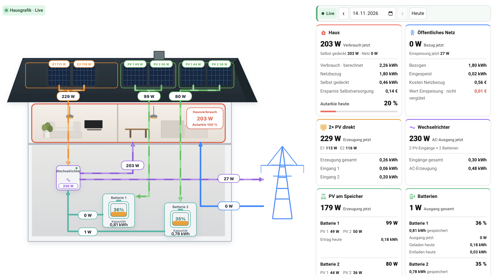

# Solar Flow Card for Home Assistant

**English** | [Deutsch](README.de.md)

**Where is your home's electricity coming from, and how much have you supplied yourself today?** Solar Flow Card brings your solar system's readings together in an animated house diagram and tiles for PV, inverter, home, grid and battery storage. See at a glance when you import or export electricity and when your battery supplies power.

The card supports **one to four direct PV inputs** at the inverter and **up to two batteries**, each with **one or two PV inputs**. With daily energy sensors, it also shows daily generation, consumption, grid imports and exports, battery energy and self-sufficiency. Optional tariffs add import costs, savings from self-supply and the value of exported electricity.

English is the default. To use German, choose **Deutsch** under **Appearance → Language** in the card editor or set `language: de` in YAML.

[Installation](README.md#installation) · [Editor setup](README.md#editor-setup) · [Daily energy sensors](README.md#creating-daily-energy-sensors) · [YAML configuration](README.md#yaml-configuration) · [Changelog](CHANGELOG.md)
